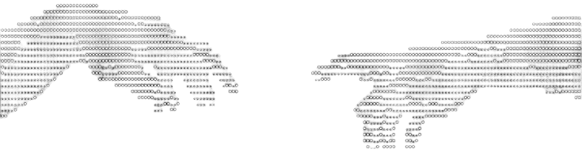

**CEHv13 | CRTA | CAP v2 | CNSP | CAPC | EHE | PenTest | Ethical Hacker | ISO 27001:2022 | IT GRC | C3SA | CySA+ | BTF | ELO 2500 BLITZ | ELO 1900 BULLETS | EXPDV**

---
### Mobile & Web Development

  
  
  
  
  
  
  
  
  
  
  
  
  
  

### Core Languages & Systems Programming

  
  
  
  
  
  
  
  
  
  
  
  
  

### Backend Development, Cloud & Infrastructure

  
  
  
  
  
  
  
  
  

### Cybersecurity & Infrastructure

  
  
  
  
  
  
  
  
  
  
  
  
  
  

### Environments & Tools

  
  
  
  
  
  
  
  
  
  
  
  
  

---

[Read More](./about.md)
